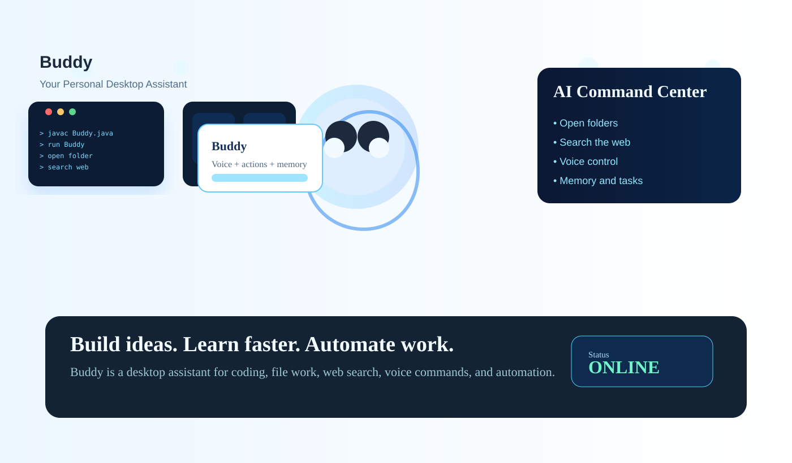
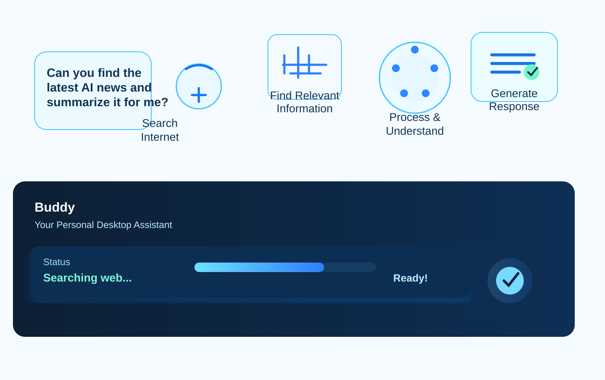
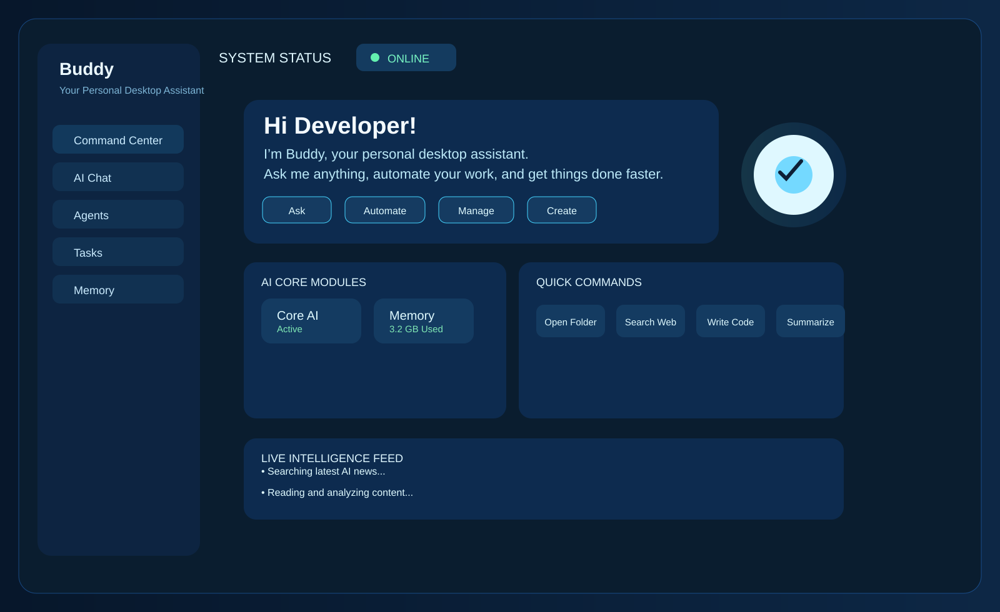

# Buddy

<p align="center">
  
</p>

<p align="center">
  <a href="#features"></a>
  <a href="#windows-support"></a>
  <a href="#voice"></a>
  <a href="#quick-start"></a>
</p>

Your Personal Desktop Assistant for coding, productivity, voice, web search, file actions, and AI-driven task automation.

## Overview

Buddy is a desktop AI assistant built in Java for Windows. It helps you work faster by turning natural language into actions on your machine.

Instead of manually opening apps, managing files, searching the web, or writing repetitive commands, Buddy tries to do the task for you.

### What it can do

- Open websites, folders, and desktop apps
- Create, rename, move, copy, and delete files or folders
- Search the web and summarize useful information
- Answer natural-language questions with local AI planning
- Remember key user facts and preferences
- Listen for voice commands and act on them
- Launch automatically when Windows starts

### Why it exists

Buddy brings together three things into one workflow:

- AI command understanding
- desktop automation
- a clean command-center interface

This project is meant to feel like a personal digital assistant running on your machine, not just a chatbot in a terminal.



## Features

Buddy was created to reduce friction between a user and their desktop. Instead of opening multiple tools manually, the assistant tries to handle the task directly:

- Open applications, websites, files, or folders
- Create, rename, copy, move, and delete folders/files
- Search the web for current news and relevant information
- Answer natural-language questions using chat and planning logic
- Keep short-term conversational memory and user-specific facts
- Listen for voice commands and process them through a bridge system
- Minimize cleanly on Windows startup so it runs without manual launch

The assistant is not only a chat bot — it is a workflow assistant that can execute tasks in context.

A sample of the aim of the project looks like this:

- Ask Buddy to create a folder
- Ask Buddy to open a document
- Ask Buddy to search the latest AI news
- Ask Buddy to open a website or app
- Ask Buddy to remember your name or preferences
- Ask Buddy what time or date it is
- Ask Buddy to do a task in plain English without writing commands

Buddy tries to translate intent into actions and then report the result clearly to the user.

### Desktop AI assistant
Buddy includes a Java Swing command center and a live dashboard experience. The interface shows:

- status indicators
- recent activity
- quick actions
- memory view
- files and folders
- web intelligence
- system health details

### Voice support
The voice layer uses a Python-based speech bridge and listens for spoken instructions. The Java side receives command events and executes tasks through the same command processor used for typed input.

### Action execution system
The project contains a strong command/action layer. Commands are processed through a central routing system that can decide whether the request is:

- a file operation
- an app open action
- a folder operation
- a search task
- a web intelligence task
- a chat answer
- a memory lookup/write action

### Web and AI intelligence
The assistant uses planner-based logic and web search integration to support web requests such as:

- latest news
- recent updates
- search analysis
- summarization flows

### Memory and context
Buddy stores useful information such as:

- user name
- preferences
- last action
- last object and location
- conversational context for follow-up requests

That makes interactions feel more natural and allows commands like “open it”, “rename it”, or “where is it?” to work in a more human way.



## Project structure

The repository is organized into a few main sections:

- src/buddy/Main.java — entry point
- src/buddy/brain/ — planning, LLM routes, memory context, and chat logic
- src/buddy/commands/ — the command routing and action execution engine
- src/buddy/actions/ — open/close/download tasks and helpers
- src/buddy/files/ — file and folder management helpers
- src/buddy/memory/ — user memory and memory extraction system
- src/buddy/ui/ — Swing dashboard and command center UI
- src/buddy/web/ — web server, search, and web intelligence
- src/buddy/resolver/ — target resolution for apps, locations, processes, and windows items
- src/voice/ — voice bridge scripts and Python speech helpers
- tests/ — smoke tests and behavior checks

### Main package overview

#### buddy.brain
This package contains the intelligence layer:

- BuddyBrain — app controller and lifecycle manager
- BuddyActionPlanner — determines action intent
- BuddyChat — chat response handling
- ConversationContext — tracks what happened recently
- OllamaBrain — model integration layer

#### buddy.commands
This package owns the execution core:

- Commands — main command dispatcher
- Command — command abstraction and routing support

#### buddy.ui
This contains the desktop UI and visual status panel:

- BuddyUI
- BuddyState
- BuddyUIEvent

#### buddy.web
This contains web-related functionality:

- BuddyWebServer
- WebSearchManager
- WebIntelligence

#### buddy.voice
This connects the Java app with the Python speech pipeline:

- BuddyVoiceBridge

## Technologies and packages used

The project is primarily Java-based, with a few supporting components.

### Java packages
The main application is written in Java, including:

- Java Swing for the desktop user interface
- AWT desktop integration for opening websites and apps
- Java NIO for file operations
- Java Preferences for local memory persistence
- Java regex and date/time utilities

### Python voice layer
The voice system uses Python scripts for:

- microphone capture
- speech recognition or wake-word processing
- command forwarding to the Java process

### Local AI integration
Buddy interacts with Ollama for the model-based planning layer:

- local LLM reasoning
- prompt routing
- natural-language task decoding

### Windows integration
The app also targets Windows app behavior for:

- file system tasks
- launching apps or websites
- closing processes
- desktop folder actions
- startup registration

## Prerequisites

Before running Buddy, make sure these are installed:

- Java JDK 17 or newer
- Python 3.x
- Ollama installed and running locally
- A working microphone if you want to use voice input
- Windows operating system for full desktop integration support

### Optional setup
You may also want:

- Vosk model files for offline voice processing
- A microphone on the machine
- Internet access for web search features

## Quick start

### 1. Clone the repository

```bash
git clone https://github.com/your-user/buddy.git
cd buddy
```

### 2. Compile the Java project

From the project root, run:

```bash
javac -cp src -d out $(find src -name "*.java")
```

On Windows PowerShell, use:

```powershell
javac -cp src -d out $(Get-ChildItem -Recurse -Filter *.java | Select-Object -Expand FullName)
```

### 3. Start Buddy

```bash
java -cp out buddy.Main
```

This starts the desktop assistant and its dashboard.

### 4. Autostart on Windows login

Buddy includes an automatic startup option. From the project root:

```bash
java -cp out buddy.Main --install-autostart
```

This copies the startup script into the Windows Startup folder so Buddy launches automatically when the user logs in.

The startup script is located in:

- buddy-startup.cmd

This approach keeps Buddy ready without requiring manual launch each time.

## Run modes

There are a few supported modes:

### Standard run

```bash
java -cp out buddy.Main
```

### Autostart run

```bash
java -cp out buddy.Main --autostart
```

### Help screen

```bash
java -cp out buddy.Main --help
```

## Example commands

Try commands such as:

```text
what is the date
what is the time
open desktop
open documents
create a folder called Projects
search latest AI news
open youtube
remember my name is Alice
what is my name
```

The assistant handles many of these directly through the command processor and UI backend.

## Current status

This project is a working desktop assistant prototype with:

- Java-based core logic
- desktop UI
- AI planning layer
- voice bridge support
- file and folder tasks
- web search support
- startup registration support

It is ready for further improvement, polishing, and packaging for real release use.

## Next improvements

The next steps for the project could include:

- packaging into an EXE or installer
- improved voice recognition tuning
- better summarization workflow
- richer memory system
- cleaner system tray mode
- user profile management
- GitHub release automation

## Conclusion

Buddy was built as a personal assistant for the desktop, designed to make everyday digital work feel faster and more natural. It combines file actions, AI reasoning, voice commands, web intelligence, and a clean UI in one system. The goal is simple: help the user do more with less manual work.

This project is a practical example of applying local AI, desktop automation, and workflow design into a single assistant experience.

---

Built with Java, Python, Windows desktop automation, AI planning, and a focus on practical productivity.
