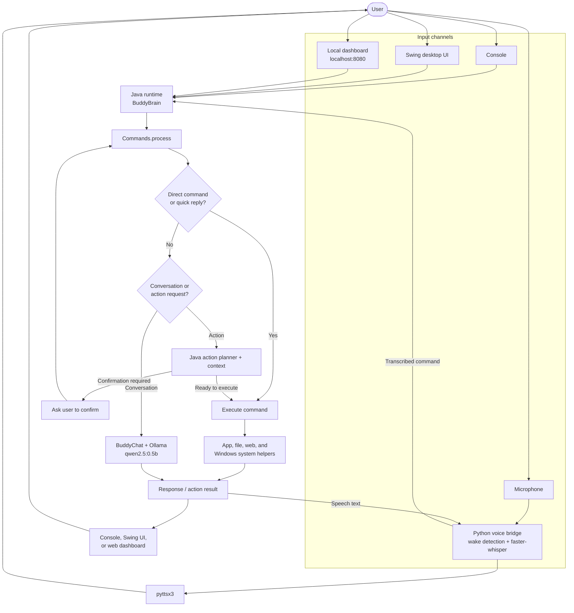

# Buddy AI Command Center

## Terminology used in this project

Before diving into the project itself, it helps to understand the key technologies and names used throughout the codebase and the system design.

- Ollama: a local AI model runtime used for natural-language reasoning and task planning. In this project, Buddy uses local model-based intelligence to interpret requests and help decide what action should happen next.
- Java: the main application runtime for the desktop assistant. It owns the command engine, app logic, workflow orchestration, and the Swing-based desktop UI.
- Python: used for the voice stack, transcription, wake detection, and text-to-speech functions. It acts as the speech layer connected to the Java application.
- Whisper / faster-whisper: a speech-to-text engine used to transcribe spoken commands and wake-word audio into readable text for processing.
- Vosk: an offline speech recognition model bundle used in the project for voice-related experimentation and local processing.
- Buddy voice bridge: the Python-to-Java communication layer that passes commands, voice events, and speech output between the assistant’s voice system and the main Java app.
- Web dashboard: the local browser-based control panel served by the Java app on localhost:8080 for interacting with the assistant via a browser.
- Action planner: the component that determines whether a request should be treated as a direct action, a conversation, or a confirmation-required step.
- Memory: user and system memory used to retain contextual information and help make future interactions more relevant.
- Wake word: the trigger phrase used to activate listening, such as “Buddy.”
- TTS: text-to-speech, the process of converting the assistant’s response text into spoken audio.

This project combines these pieces into one assistant that can listen, reason, act, and respond in a desktop environment.

---

Buddy is a desktop-style AI assistant project that combines a Java command system, a Swing-based user interface, a local web dashboard, and a voice-driven interaction layer. The project is designed to behave like an intelligent desktop helper: it can accept natural language instructions, route them through action planning, launch apps or files, browse the web, and respond through both text and voice.

This repository contains the working implementation, supporting scripts, Python voice bridge, and test files used to validate the system. The project evolved as a practical assistant that is focused on being useful in real desktop workflows rather than only demonstrating a toy chat loop.

---

## 1. Project overview

The central idea behind Buddy is simple: take a command from the user, understand the intent, decide whether it is a normal conversation or an actionable task, and then perform the request in the most direct way possible.

At the application level, the project is organized into a few clear layers:

- Java application core and command processing
- Swing-based desktop UI for status, actions, and system feedback
- Local web dashboard for browser-based interaction
- Python voice stack for wake-word detection, speech recognition, and text-to-speech
- Memory, file, app, and target resolution helpers for real-world actions

The main runtime entry point is [src/buddy/Main.java](src/buddy/Main.java), which starts the assistant and handles common startup flags such as autostart, command execution, and help mode.

### Tech stack

| Area | Technologies |
| --- | --- |
| Main application | Java, Swing |
| AI and local inference | Ollama HTTP API (`qwen2.5:0.5b` for chat; `llama3.2` is configured in the `OllamaBrain` command-understanding class) |
| Voice input | Python, NumPy, sounddevice, faster-whisper |
| Voice output | pyttsx3 |
| Web interface | Java local HTTP server and browser-based dashboard (`localhost:8080`) |
| Desktop integration | Windows app, process, and file management; PowerShell and command scripts for build and startup |
| Build and tests | JDK tools (`javac`, `jar`); Java test programs in `tests/` |

The voice bridge and its Python packages are used when voice mode is enabled. The repository also includes a Vosk model bundle for offline speech-related workflows.

---

## 2. What was created in this project

The project includes both the software itself and the supporting operating pieces that allow it to run in a real environment.

### Java application core

The Java portion is the heart of the assistant. It handles the command pipeline, conversations, app launching, file actions, web tasks, and user interaction processing.

Key files:

- [src/buddy/Main.java](src/buddy/Main.java) – entry point and startup configuration
- [src/buddy/brain/BuddyBrain.java](src/buddy/brain/BuddyBrain.java) – main runtime orchestration for UI, web server, and voice bridge
- [src/buddy/commands/Commands.java](src/buddy/commands/Commands.java) – central task execution logic and command routing
- [src/buddy/ui/BuddyUI.java](src/buddy/ui/BuddyUI.java) – desktop interface and activity/status panels
- [src/buddy/web/BuddyWebServer.java](src/buddy/web/BuddyWebServer.java) – local HTTP web dashboard and command API

### Assistant logic and planning

The assistant is not just a fixed list of keywords. It includes a structured planning flow that tries to understand whether an instruction should be handled as a direct action, a conversational response, or a confirmation-based operation.

Important source links:

- [src/buddy/brain/BuddyActionPlanner.java](src/buddy/brain/BuddyActionPlanner.java)
- [src/buddy/brain/BuddyActionPlan.java](src/buddy/brain/BuddyActionPlan.java)
- [src/buddy/brain/BuddyChat.java](src/buddy/brain/BuddyChat.java)
- [src/buddy/brain/ConversationContext.java](src/buddy/brain/ConversationContext.java)
- [src/buddy/brain/OllamaBrain.java](src/buddy/brain/OllamaBrain.java)

These files support the assistant’s decision-making pipeline and allow it to reason about context, planning, and follow-up confirmations.

### App, file, memory, and resolver systems

Buddy is designed to do more than answer questions. It interacts with the system in practical ways by managing files, launching apps, resolving targets, and remembering items from prior interactions.

Source links:

- [src/buddy/actions/ActionManager.java](src/buddy/actions/ActionManager.java)
- [src/buddy/apps/AppManager.java](src/buddy/apps/AppManager.java)
- [src/buddy/files/FileManager.java](src/buddy/files/FileManager.java)
- [src/buddy/memory/MemoryManager.java](src/buddy/memory/MemoryManager.java)
- [src/buddy/memory/MemoryExtractor.java](src/buddy/memory/MemoryExtractor.java)
- [src/buddy/resolver/TargetResolver.java](src/buddy/resolver/TargetResolver.java)
- [src/buddy/resolver/WindowsAppResolver.java](src/buddy/resolver/WindowsAppResolver.java)
- [src/buddy/resolver/WindowsLocationResolver.java](src/buddy/resolver/WindowsLocationResolver.java)
- [src/buddy/resolver/WindowsProcessResolver.java](src/buddy/resolver/WindowsProcessResolver.java)

These modules are what make Buddy feel like a workstation assistant rather than a command script.

### Voice interface and Python bridge

The voice layer is implemented in Python and is connected to the Java system through a bridge. It listens for a wake word, captures voice commands, transcribes them, and sends results back into the Java command system.

Key voice files:

- [voice/buddy_voice.py](voice/buddy_voice.py)
- [voice/buddy_voice_high_accuracy.py](voice/buddy_voice_high_accuracy.py)
- [voice/buddy_voice_high_accuracy_bridge.py](voice/buddy_voice_high_accuracy_bridge.py)
- [voice/brain_test.py](voice/brain_test.py)
- [voice/brain_action_test.py](voice/brain_action_test.py)
- [voice/wake_test.py](voice/wake_test.py)
- [voice/voice_test.py](voice/voice_test.py)
- [voice/test_mic.py](voice/test_mic.py)

The bridge file is especially important because it manages the communication channel between Python voice recognition and the Java runtime, including wake detection and speech-to-text work.

### Automation and Windows integration

The project also includes startup and desktop integration scripts so Buddy can launch more like a real local assistant application.

- [buddy-startup.cmd](buddy-startup.cmd)
- [buddy-run.cmd](buddy-run.cmd)
- [install-desktop-shortcut.ps1](install-desktop-shortcut.ps1)
- [build.ps1](build.ps1)

These scripts help with local execution, startup registration, and building the packaged Java application.

---

## 3. Project outputs and generated artifacts

This project generates several real outputs that can be used directly after building.

### Runtime artifacts

- [.dist/Buddy.jar](.dist/Buddy.jar) – packaged Java executable created by the build script
- [out](out) – compiled class output directory used during local development and testing
- [assets](assets) – graphical and UX-related assets used by the app

### Web dashboard output

When the Java app runs, Buddy starts a local HTTP server and exposes a dashboard at:

- http://localhost:8080

This dashboard is implemented in [src/buddy/web/BuddyWebServer.java](src/buddy/web/BuddyWebServer.java). It provides a lightweight browser-based control surface and exposes a command API for interaction.

### Voice system output

The voice subsystem listens for the wake word “Buddy,” records command speech, transcribes audio, and then feeds the recognized text back into the Java processing engine. This live interaction model is managed by the Python bridge and the Java command system together.

### Model and speech resources

The project includes a local speech model bundle:

- [vosk-model-small-en-us-0.15/README](vosk-model-small-en-us-0.15/README)

This gives the assistant access to a local offline speech model for wake and transcription workflows.

### Test output and verification

The project also includes a meaningful test set to validate the assistant’s behavior:

- [tests/BuddyUISmokeTest.java](tests/BuddyUISmokeTest.java)
- [tests/CommandLineModeTest.java](tests/CommandLineModeTest.java)
- [tests/CommandsBehaviorTest.java](tests/CommandsBehaviorTest.java)

These tests cover UI smoke behavior, command-line mode, and command execution flows.

---

## 4. How the system works

Commands can arrive through the console, Swing UI, local web dashboard, or the Python voice bridge. This diagram shows how Buddy routes a request and returns a result:



This design keeps the code understandable while still making the assistant flexible enough to handle a real set of desktop activities.

---

## 5. Build and run instructions

### Build the project

From the project root, run:

```powershell
powershell -ExecutionPolicy Bypass -File .\build.ps1
```

This script scans the Java files, compiles them into [out](out), and packages the app into [.dist/Buddy.jar](.dist/Buddy.jar).

### Run the project

Use either of these methods:

```powershell
java -cp out buddy.Main
```

or

```powershell
.\buddy-run.cmd
```

The startup command also checks whether the jar already exists and builds it if needed.

### Autostart mode

Buddy includes a Windows startup script for automatic launch:

```powershell
.\buddy-startup.cmd
```

This is useful for running the assistant in the background when the machine starts.

---

## 6. Why this project matters

Buddy is more than a coding exercise. It is a functional assistant project that blends several disciplines into one working system:

- Java application architecture
- frontend-style desktop UI design
- local web API integration
- Python-based speech recognition and TTS
- action planning and reasoning
- practical file and app automation on Windows

The project demonstrates how multiple runtime layers can be connected to behave like an AI-driven productivity assistant. It is intentionally practical, with a clear desktop-oriented design and a real runtime workflow rather than a purely academic example.

---

## 7. Repository summary

This repository brings together all of the pieces needed for a working assistant project:

- Java execution layer: [src](src)
- Voice subsystem: [voice](voice)
- Tests: [tests](tests)
- Build and startup scripts: [build.ps1](build.ps1), [buddy-run.cmd](buddy-run.cmd), [buddy-startup.cmd](buddy-startup.cmd)
- Generated outputs: [.dist](.dist), [out](out)
- Supporting project files: [Buddy.iml](Buddy.iml), [.gitignore](.gitignore)

The project is best understood as a working local AI assistant prototype that combines desktop interaction, web control, and voice-driven automation in one codebase.

---

## 8. Final note

The repository is a strong example of a real-world assistant built from multiple moving parts. It is intentionally practical, with direct startup scripts, local model support, and a command-processing pipeline that can evolve into a broader personal productivity system.

If you continue developing Buddy, the most natural next steps would be improving intent detection, adding safer confirmation flows, broadening app automation, and refining voice command quality for more reliable daily usage.
